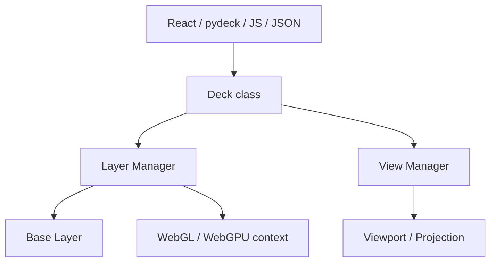

# visgl/deck.gl

> WebGL2/WebGPU library for visualizing large datasets as layers, for web and data developers.

## The problem
Displaying hundreds of thousands of points or polygons on a map makes conventional visualizations lag.

## What it actually does
Turns an array of JSON objects into a stack of layers (icons, polygons, text) viewed through views (map, first-person, orthographic). Handles picking, highlighting, filtering, map projections and basemaps. Usable as a script, via npm, React or Python (pydeck).

## How it is wired


## Trying it
```bash
npm install deck.gl
pip install pydeck
```

## Cost and gotchas
Free. Requires a WebGL2 or WebGPU browser. Third-party basemaps may be needed depending on usage. 631 open issues.

## What it is not
Not a turnkey BI tool: you write code. Not a data engine: it displays, it does not compute for you.

## Alternatives
No alternative named in the README (third-party extensions listed: mapdeck for R, vega-deck.gl).

## For you
Adopt: pydeck lets you map large geospatial volumes straight from a notebook; the project is active and mature.
