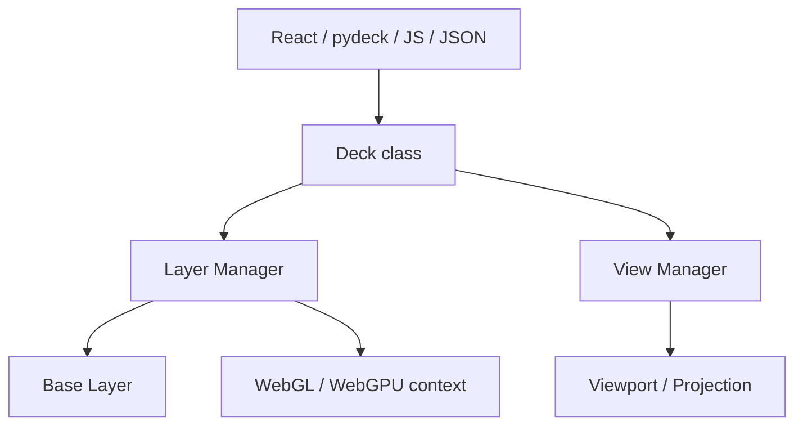

# visgl/deck.gl

> Bibliothèque WebGL2/WebGPU pour visualiser de grands jeux de données en couches, pour développeurs web et data.

## Le problème
Afficher des centaines de milliers de points ou de polygones sur une carte fait ramer les visualisations classiques.

## Ce que ça fait vraiment
Transforme un tableau d'objets JSON en pile de couches (icônes, polygones, texte) regardées via des vues (carte, première personne, orthographique). Gère picking, surbrillance, filtrage, projections cartographiques et fonds de carte. Utilisable en script, npm, React ou Python (pydeck).

## Comment c'est branché


## Essayer
```bash
npm install deck.gl
pip install pydeck
```

## Coût et pièges
Gratuit. Nécessite un navigateur WebGL2 ou WebGPU. Fonds de carte tiers possibles selon l'usage. 631 issues ouvertes.

## Ce que ce n'est pas
Pas un outil de BI clé en main : on écrit du code. Pas un moteur de données : il affiche, il ne calcule pas à ta place.

## Alternatives
Aucune alternative nommée dans le README (extensions tierces listées : mapdeck pour R, vega-deck.gl).

## Pour toi
Adopter : pydeck permet de cartographier de gros volumes géospatiaux directement depuis un notebook, projet actif et mature.

