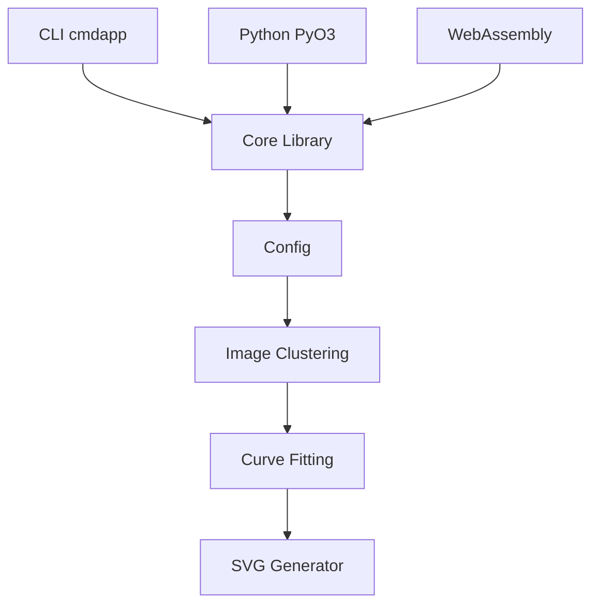

# visioncortex/vtracer

> Converter of raster images (jpg, png) into compact vector SVG, as a CLI, library or app.

## The problem
Vectorizing a color image or scan by hand is slow; Potrace only handles black and white and Illustrator produces heavy files.

## What it actually does
Segments the image by color clustering (or watershed), fits curves, then writes an SVG. Options: bw, poster and photo presets, fixed palette, adaptive thresholding, curve simplification. Usable as a Rust CLI, in Python (pip) and in Node (WebAssembly). Version 1.0 is announced as alpha in the README.

## How it is wired
Simplified diagram based on the fiche and the diagram provided.



## Trying it
```bash
cargo install vtracer-cli
./vtracer input.jpg output.svg
./vtracer input.jpg output.svg --preset bw
pip install vtracer==1.0.0a4
npm install @visioncortex/vtracer@1.0.0-alpha.4
```

## Cost and gotchas
Free, nothing to sign up for. The real requirement is a Rust toolchain to compile (cargo); otherwise binaries are provided in the releases. The pip and npm packages are in alpha.

## What it is not
Not an image editing tool nor an AI model: it is algorithmic tracing. A complex photo yields a stylized SVG, not a faithful copy.

## Alternatives
- Potrace: simpler and proven for black and white only.
- Adobe Illustrator Image Trace: built into Illustrator, but heavier outputs according to the README.

## For you
Worth watching: useful for vectorizing diagrams or scans in a data pipeline, but the 1.0 API is still in alpha.
