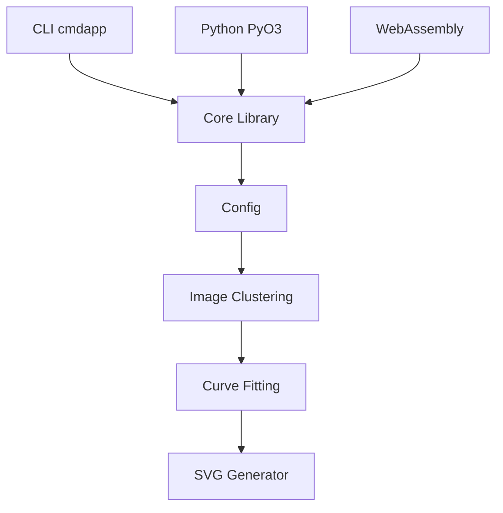

# visioncortex/vtracer

> Convertisseur d'images raster (jpg, png) en SVG vectoriel compact, en CLI, bibliothèque ou appli.

## Le problème
Vectoriser une image ou un scan couleur à la main est long ; Potrace ne gère que le noir et blanc et Illustrator produit des fichiers lourds.

## Ce que ça fait vraiment
Segmente l'image par clustering de couleurs (ou watershed), ajuste des courbes puis écrit un SVG. Options : presets bw, poster, photo, palette fixe, seuillage adaptatif, simplification des courbes. Utilisable en CLI Rust, en Python (pip) et en Node (WebAssembly). La version 1.0 est annoncée en alpha dans le README.

## Comment c'est branché
Schéma simplifié d'après la fiche et le diagramme fourni.



## Essayer
```bash
cargo install vtracer-cli
./vtracer input.jpg output.svg
./vtracer input.jpg output.svg --preset bw
pip install vtracer==1.0.0a4
npm install @visioncortex/vtracer@1.0.0-alpha.4
```

## Coût et pièges
Gratuit, rien à créer. Le besoin réel est une toolchain Rust pour compiler (cargo) ; sinon des binaires sont fournis en releases. Les paquets pip et npm sont en alpha.

## Ce que ce n'est pas
Pas un outil de retouche d'image ni un modèle d'IA : c'est un traçage algorithmique. Une photo complexe donne un SVG stylisé, pas une copie fidèle.

## Alternatives
- Potrace : plus simple et éprouvé pour le noir et blanc seulement.
- Adobe Illustrator Image Trace : intégré à Illustrator, mais sorties plus lourdes selon le README.

## Pour toi
À surveiller : utile pour vectoriser des schémas ou scans dans un pipeline de données, mais l'API 1.0 est encore en alpha.

