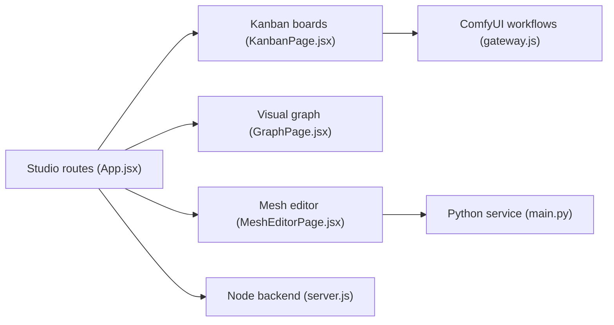

# visualbruno/3DGenStudio

> Local 3D production studio that orchestrates ComfyUI and external APIs, from image to textured mesh.

## The problem
Going from an image to a textured 3D mesh chains several tools (text to image, editing, mesh generation, UV, texture) that have to be tracked by hand.

## What it actually does
A Kanban and graph workspace where each card moves through stages (images, editing, mesh, editing, texture) by running ComfyUI workflows or REST/GraphQL APIs. It includes an asset library, a mesh editor (sculpting, painting, UV, retopology, rigging, LOD, bake) and a Python service (Blender `bpy`); the architecture also mentions an MCP server and Unity/Unreal importers. Projects are stored locally on disk.

## How it is wired


## Trying it
```bash
git clone https://github.com/visualbruno/3DGenStudio.git
cd 3DGenStudio
npm install
npm run dev
cd python-server
python -m venv .venv
pip install -r requirements.txt
python main.py
```

## Cost and gotchas
Requires a ComfyUI installation and often a GPU for the models. The motion mode (Kimodo) downloads Meta Llama 3-8B (~16 GB) under a Meta license, which you must accept. On macOS: Apple Silicon only, app not notarized. The repository license was not identified by GitHub.

## What it is not
Not a 3D generation model: it drives other tools. Not a cloud solution.

## Alternatives
No alternative named in the README (TripoSR and Wonder3D are cited as workflow examples).

## For you
Worth watching: a good example of ComfyUI orchestration as a pipeline, but young, single-author, and heavy on prerequisites.
