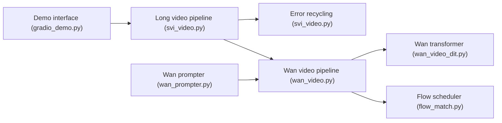

# vita-epfl/Stable-Video-Infinity

> Method and LoRA weights to generate videos of unlimited length from Wan 2.1.

## The problem
Video models drift and forget when a video is extended beyond a few seconds.

## What it actually does
SVI adds LoRA adapters to the Wan 2.1 I2V 14B model, trained with "Error-Recycling Fine-Tuning": the transformer's errors are fed back in and memorized so that it learns to correct them. Variants: SVI-2.0, Shot, Film, Tom&Jerry, Talk (audio), Dance (skeleton). The repository provides inference and training scripts, a Gradio demo, a ComfyUI workflow and test datasets.

## How it is wired


## Trying it
```bash
conda create -n svi python=3.10
conda activate svi
pip install -e .
huggingface-cli download Wan-AI/Wan2.1-I2V-14B-480P --local-dir ./weights/Wan2.1-I2V-14B-480P
bash scripts/test/svi_shot.sh
```

## Cost and gotchas
Tested on an A100 80 GB; training tested on 8 and 64 GPUs; base weights of several tens of GB. `flash_attn` sometimes installs badly. The SVI-2.0 block in the README is truncated (unclosed code block).

## What it is not
Not a laptop-ready tool: it needs a datacenter GPU. The public ComfyUI workflows only include SVI-Shot.

## Alternatives
No alternative named in the README (Self-Forcing is cited as a different approach).

## For you
Worth watching: open, reproducible research on long video, useful if you have GPUs; otherwise worth reading for the idea.
