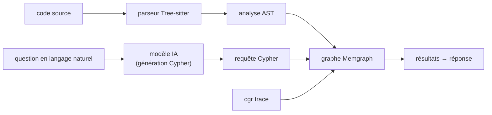

# vitali87/code-graph-rag

> Indexes a multi-language monorepo into a knowledge graph and queries it in natural language.

## The problem
A classic RAG splits code into text chunks and loses calls, inheritance and modules:
structural questions ("who calls this?", "which code is dead?") remain unanswered.

## What it actually does
A Tree-sitter parser reads each source file and ingests functions, classes, methods, modules and
their relationships into Memgraph under a single, language-independent schema. Then `codebase_rag/`
translates the question into Cypher, retrieves the real code, and drives editing and optimization: a
surgical AST patch with diff preview, dead code detection by walking call edges back from
the entry points, structural search-and-rewrite via ast-grep. `cgr trace` additionally merges the
calls that actually occurred during a test or an eBPF profile, which static analysis cannot see.

## How it is wired


## Trying it
```bash
uv tool install "code-graph-rag[treesitter-full,semantic]"
# ou : pipx install "code-graph-rag[treesitter-full,semantic]"
cgr daemon up
cgr start --repo-path /path/to/repo --update-graph
cgr start --repo-path /path/to/repo
uv tool install "code-graph-rag[treesitter-full,semantic] @ git+https://github.com/vitali87/code-graph-rag@main"
```

## Cost and gotchas
Python 3.12+, Docker (Memgraph), `cmake` and `ripgrep` required. Cypher generation goes through an
AI model: the key is at your expense. `--clean` destroys **all** projects in the shared graph, not
just the current one. PyPI only publishes one version in 50: the `main` tag is far ahead.

## What it is not
Not a code vector database: the `semantic` extra is an add-on but the core is a Cypher graph.
Not free to use without thought: paid managed cloud, on-premise and air-gapped offers are
promoted, which suggests an open-core model.

## Alternatives
No alternative named: the README cites its building blocks (Tree-sitter, Memgraph, Qdrant, ast-grep).

## For you
The most credible of the "RAG on code" projects I have seen: to test on a real monorepo.
