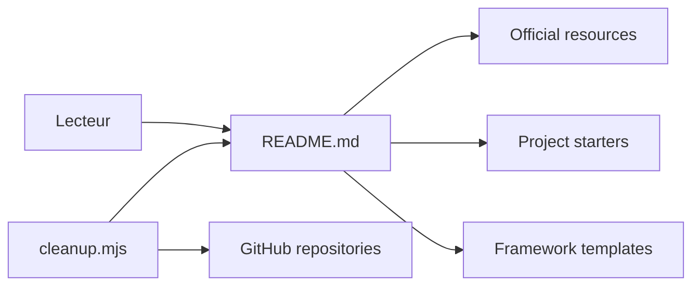

# vitejs/awesome-vite

> Curated list of resources, templates, plugins and integrations around Vite, for front-end developers.

## The problem
The Vite ecosystem has hundreds of scattered plugins and templates; finding the right starting point means digging through npm and GitHub.

## What it actually does
A README sorted by category: official resources, starter tools, templates (Vue, React, Svelte, Solid, Electron...), plugins (integrations, loaders, bundling, tests, security), SSR, backend integrations (Django, Rails, Laravel, Go...), migrations and projects using Vite. A `cleanup.mjs` script checks the linked repositories and removes those with no commit in six months. The README states that the plugin list is no longer updated and points to the Vite Plugin Registry.

## How it is wired

## Trying it
No documented command: you read the README.

## Cost and gotchas
Free. Part of the list is outdated (the README says so for plugins); check the freshness of each link.

## What it is not
Not a tool or a library: no application code, just a directory. Not the official Vite repository.

## Alternatives
- Vite Plugin Registry (cited in the README): lists plugins published on npm, more up to date.
- Awesome Vue (cited in the official resources) for the Vue side.

## For you
Worth watching only: useful for finding a template if you build a demo interface for a model, but nothing specific to data/AI.
