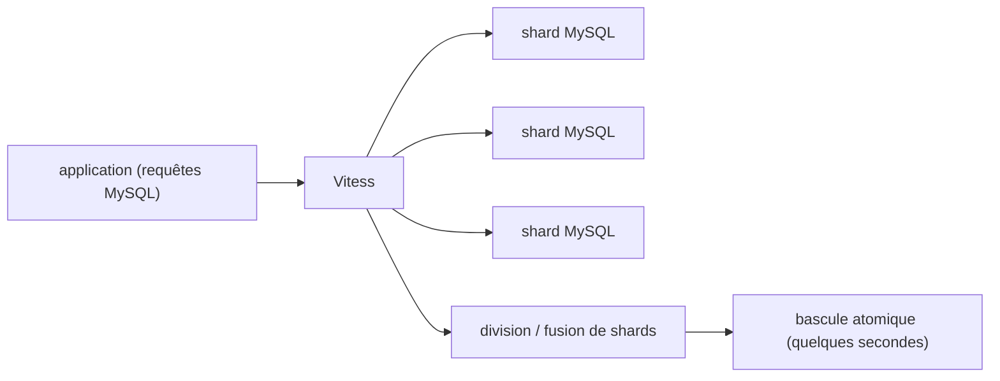

# vitessio/vitess

> Distributed, horizontally scalable database system built around MySQL.

## The problem
A single MySQL eventually saturates, and sharding the data forces you to rewrite application code
and queries to know where each row is stored.

## What it actually does
Vitess aims at unlimited scaling through generalized sharding. Application code and queries stay
indifferent to how data is spread across several database servers. Shards can be split and merged as
needs grow, with an atomic cutover step that lasts only a few seconds. The README describes neither
the architecture nor the installation: it points to `vitess.io`, the project's Slack and the security
process, and mentions an external security audit carried out by ADA Logics.

## How it is wired

## Trying it
No command is documented in this README: it points to the `vitess.io` site.

## Cost and gotchas
The real cost is operational: tens of thousands of MySQL nodes at YouTube give the order of magnitude
of the intended scale. The README mentions no license, no prerequisites and no operating procedure.

## What it is not
Not a replacement for MySQL: it is a layer around MySQL, which remains necessary. Not a workstation
tool nor a small-deployment tool. This README is not documentation — it is a presentation page with
contact channels.

## Alternatives
No alternative is named in the README.

## For you
Out of scope: ignore unless you one day inherit a MySQL at the end of its capacity.
