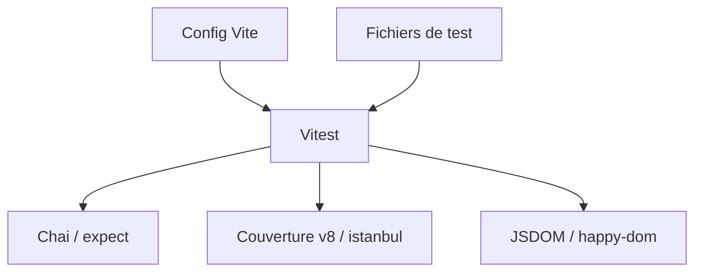

# vitest-dev/vitest

> JavaScript and TypeScript testing framework built on Vite, for front-end and Node developers.

## The problem
Jest requires a configuration separate from the application's and handles ESM and TypeScript poorly.

## What it actually does
Reuses Vite's configuration and plugins. Provides Jest-compatible assertions (Chai built in), snapshots, mocks, v8 or istanbul coverage, fast watch mode, browser mode, component tests (Vue, React, Svelte), Tinybench benchmarks and sharding. Requires Vite >= 6.4.0 and Node >= 22.12.0.

## How it is wired
Simplified diagram based on the fiche, no diagram provided.



## Trying it
```bash
npx vitest
```

## Cost and gotchas
Free. Minimum Vite and Node versions must be respected. No heavy prerequisites.

## What it is not
Not a Python testing tool. Not a universal replacement: designed for the Vite ecosystem. The README is short and points to the guide.

## Alternatives
- Jest: API taken over by Vitest, cited in the acknowledgments.
- uvu: source of inspiration cited in the README.

## For you
Worth watching: relevant only if you write JavaScript interfaces around your models; otherwise pytest covers your daily needs.
