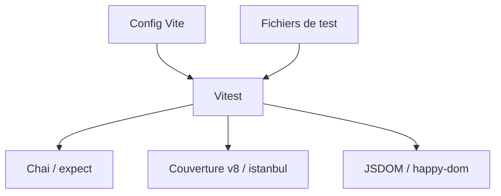

# vitest-dev/vitest

> Framework de tests JavaScript et TypeScript fondé sur Vite, pour développeurs front-end et Node.

## Le problème
Jest demande une configuration à part de celle de l'application et gère mal l'ESM et TypeScript.

## Ce que ça fait vraiment
Réutilise la configuration et les plugins de Vite. Fournit des assertions compatibles Jest (Chai intégré), snapshots, mocks, couverture v8 ou istanbul, mode watch rapide, mode navigateur, tests de composants (Vue, React, Svelte), benchmarks Tinybench et sharding. Exige Vite >= 6.4.0 et Node >= 22.12.0.

## Comment c'est branché
Schéma simplifié d'après la fiche, sans diagramme fourni.



## Essayer
```bash
npx vitest
```

## Coût et pièges
Gratuit. Versions minimales de Vite et Node à respecter. Aucun prérequis lourd.

## Ce que ce n'est pas
Pas un outil de test Python. Pas un remplaçant universel : conçu pour l'écosystème Vite. Le README est court et renvoie au guide.

## Alternatives
- Jest : API reprise par Vitest, citée dans les remerciements.
- uvu : source d'inspiration citée dans le README.

## Pour toi
À surveiller : pertinent seulement si tu écris des interfaces JavaScript autour de tes modèles ; sinon pytest couvre ton quotidien.

