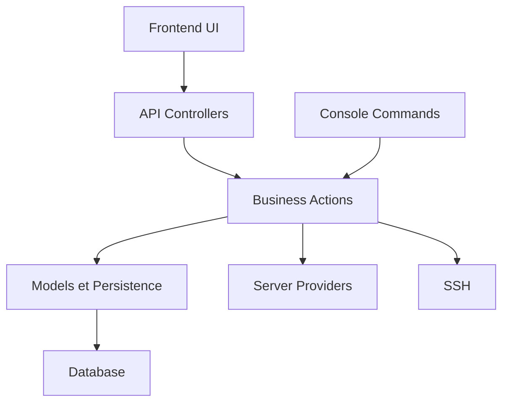

# vitodeploy/vito

> Self-hosted web application for managing servers and deploying PHP applications such as Laravel.

## The problem
Provisioning a server and installing a database, SSL, cron and deployments by hand takes time and relies on SSH commands.

## What it actually does
A Laravel and React dashboard that drives your servers over SSH: MySQL and MariaDB databases, firewall, Let's Encrypt or custom certificates, workers via supervisor, SSH keys, cron jobs, domains and DNS. It also offers an API, plugins, workflows and import-export.

## How it is wired


## Trying it
```bash
bash <(curl -Ls https://raw.githubusercontent.com/vitodeploy/vito/4.x/scripts/install.sh)
```

## Cost and gotchas
Free, AGPL-3.0. The install script is run directly from the internet. You need a server to dedicate to it. A Docker installation is mentioned without detail in this README.

## What it is not
Not a tool for deploying models or containers: it targets PHP applications. Not a Kubernetes platform. The AGPL imposes its obligations if you expose a modified version.

## Alternatives
No alternative named in the README.

## For you
Ignore: PHP-oriented, it is of no use for deploying data services or models.
