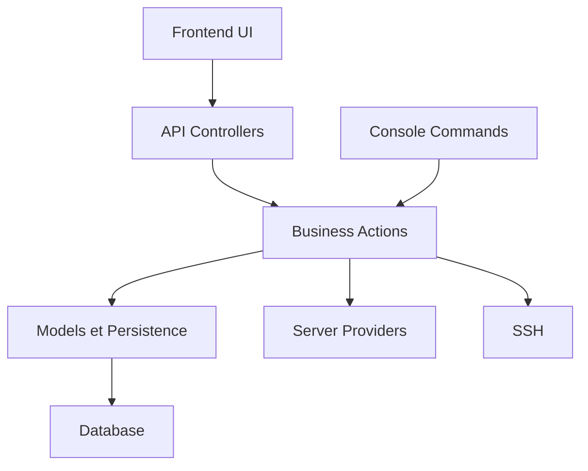

# vitodeploy/vito

> Application web auto-hébergée pour gérer des serveurs et déployer des applications PHP comme Laravel.

## Le problème
Provisionner un serveur, y installer base de données, SSL, cron et déploiements à la main prend du temps et dépend de commandes SSH.

## Ce que ça fait vraiment
Un tableau de bord Laravel et React qui pilote tes serveurs par SSH : bases MySQL et MariaDB, pare-feu, certificats Let's Encrypt ou personnalisés, workers via supervisor, clés SSH, tâches cron, domaines et DNS. Il offre aussi une API, des plugins, des workflows et un import-export.

## Comment c'est branché


## Essayer
```bash
bash <(curl -Ls https://raw.githubusercontent.com/vitodeploy/vito/4.x/scripts/install.sh)
```

## Coût et pièges
Gratuit, AGPL-3.0. Le script d'installation est exécuté directement depuis internet. Il faut un serveur à dédier. Une installation Docker est mentionnée sans détail dans ce README.

## Ce que ce n'est pas
Pas un outil de déploiement de modèles ou de conteneurs : il cible les applications PHP. Pas une plateforme Kubernetes. L'AGPL impose ses obligations si tu l'exposes modifié.

## Alternatives
Aucune alternative nommée dans le README.

## Pour toi
À ignorer : orienté PHP, il ne sert pas à déployer des services data ou des modèles.

