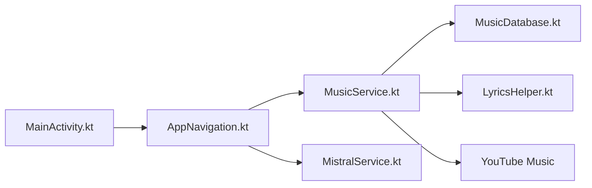

# vivizzz007/vivi-music

> Android music player that streams from YouTube Music, with synchronized lyrics and a Material You interface.

## The problem
Listening to YouTube Music without ads requires the paid official app.

## What it actually does
Streaming playback, persistent queues, downloads, equalizer, word-by-word synchronized lyrics, music recognition (Shazam), cast, "Listen Together", AI translation (Mistral, OpenRouter) and OTA updates via GitHub. Claims zero data collection. Inspired by Metrolist.

## How it is wired

## Trying it
No installation command; only the git contribution flow is described (fork, branch, commit, pull request).

## Cost and gotchas
Free. Relies on YouTube Music in an unofficial way (risk of being blocked). License "present but unidentified". Android Auto requires enabling "Unknown sources".

## What it is not
Not an official service, nor affiliated with YouTube. The privacy promise is a README claim, not audited here.

## Alternatives
Metrolist (cited in the README): the original project this one is inspired by.

## For you
Ignore: a consumer player of dubious legality on YouTube, unrelated to your work.
