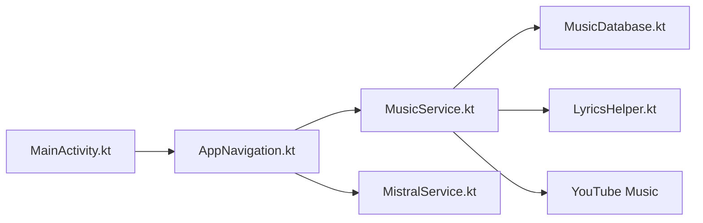

# vivizzz007/vivi-music

> Lecteur de musique Android en continu depuis YouTube Music, avec paroles synchronisées et interface Material You.

## Le problème
Écouter YouTube Music sans publicité demande l'application officielle payante.

## Ce que ça fait vraiment
Lecture en continu, files persistantes, téléchargements, égaliseur, paroles synchronisées mot à mot, reconnaissance musicale (Shazam), cast, « Listen Together », traduction par IA (Mistral, OpenRouter) et mises à jour OTA via GitHub. Annonce zéro collecte de données. Inspiré de Metrolist.

## Comment c'est branché

## Essayer
Aucune commande d'installation ; seul le flux de contribution git est décrit (fork, branche, commit, pull request).

## Coût et pièges
Gratuit. S'appuie sur YouTube Music de façon non officielle (risque de blocage). Licence « présente mais non identifiée ». Android Auto demande d'activer « Sources inconnues ».

## Ce que ce n'est pas
Pas un service officiel ni affilié à YouTube. La promesse de confidentialité est une déclaration du README, non auditée ici.

## Alternatives
Metrolist (cité dans le README) : projet d'origine dont celui-ci s'inspire.

## Pour toi
Ignorer : lecteur grand public à la légalité douteuse sur YouTube, sans lien avec ton métier.

