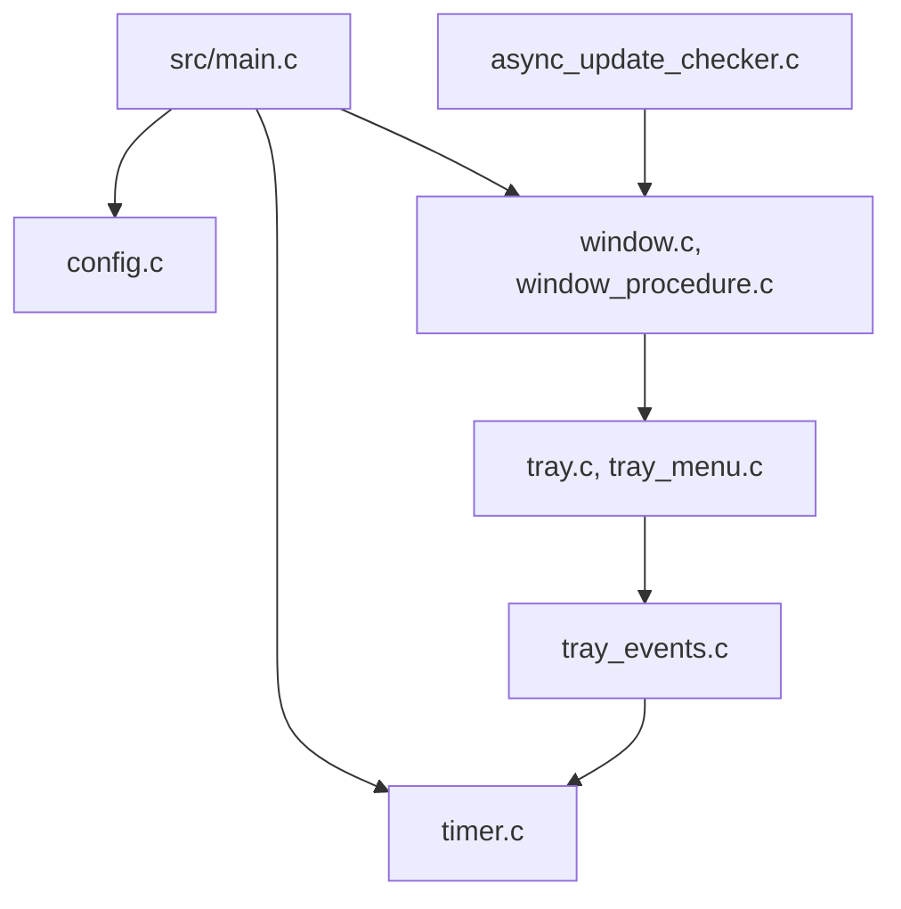

# vladelaina/Catime

> Windows timer and Pomodoro app written in C, transparent and lightweight (995 KB), with animations in the system tray.

## The problem
Classic timers are heavy or intrusive, when all you want is a discreet countdown on screen.

## What it actually does
Displays a transparent, movable and resizable countdown, with Pomodoro, a tray menu and custom fonts. The icon can be animated (GIF, WebP, ANI) or show CPU, memory and battery usage. External modules write to `./output.txt`, which the application displays live.

## How it is wired


## Trying it
```bash
scoop bucket add extras
scoop install catime
winget install --id VladElaina.Catime
chmod +x build.sh && ./build.sh
```

## Cost and gotchas
Free (Apache-2.0), Windows. Built with MinGW and CMake. The icon and the wallpaper are reserved to a third party (no commercial use without permission); several fonts have their own licenses.

## What it is not
Not a task manager or a time-tracking tool. The "Project Status" section of the README is empty.

## Alternatives
No alternative cited in the README (companion projects MemeTray and Catime-Plugins).

## For you
Ignore: a desktop timer, unrelated to data, AI or MLOps work.
