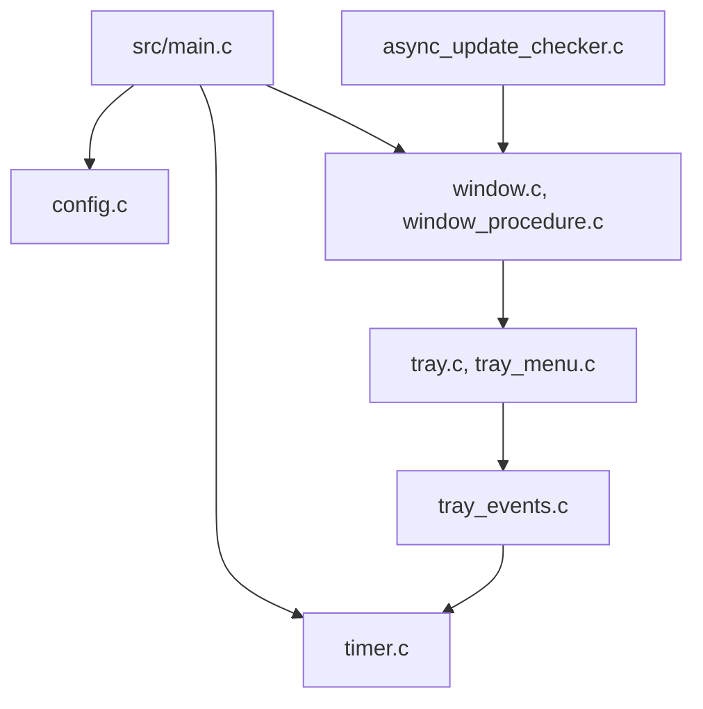

# vladelaina/Catime

> Minuteur et Pomodoro Windows écrit en C, transparent et léger (995 Ko), avec animations dans la barre d'état.

## Le problème
Les minuteurs classiques sont lourds ou envahissants, alors qu'on veut juste un compte à rebours discret à l'écran.

## Ce que ça fait vraiment
Affiche un compte à rebours transparent, déplaçable et redimensionnable, avec Pomodoro, menu de la barre d'état et polices personnalisées. L'icône peut être animée (GIF, WebP, ANI) ou montrer l'usage CPU, mémoire et batterie. Des modules externes écrivent dans `./output.txt`, que l'application affiche en direct.

## Comment c'est branché


## Essayer
```bash
scoop bucket add extras
scoop install catime
winget install --id VladElaina.Catime
chmod +x build.sh && ./build.sh
```

## Coût et pièges
Gratuit (Apache-2.0), Windows. Compilation avec MinGW et CMake. L'icône et le fond d'écran sont réservés à un tiers (pas d'usage commercial sans accord) ; plusieurs polices ont leurs propres licences.

## Ce que ce n'est pas
Pas un gestionnaire de tâches ni un outil de suivi du temps. La section « Project Status » du README est vide.

## Alternatives
Aucune alternative citée dans le README (projets compagnons MemeTray et Catime-Plugins).

## Pour toi
À ignorer : minuteur de bureau, sans rapport avec un travail data, IA ou MLOps.

