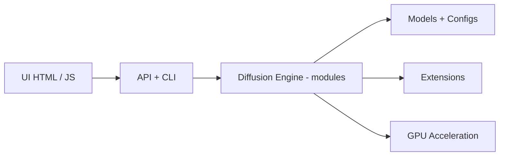

# vladmandic/automatic

> All-in-one web interface (SD.Next) to generate, caption and process images and videos with diffusion.

## The problem
Using dozens of diffusion models on varied hardware without assembling the dependencies yourself.

## What it actually does
Server and WebUI derived from AUTOMATIC1111, with automatic model download, SDNQ quantization (up to 4x less VRAM according to the README), balanced CPU/GPU offloading, captions from 25 LLM/VLM models, image editing, extensions, and platform detection (NVIDIA, AMD, Intel Arc, macOS, DirectML, OpenVINO, ZLUDA). Desktop and mobile interfaces, about 15 languages.

## How it is wired


## Trying it
```bash
git clone https://github.com/vladmandic/sdnext
cd sdnext
./webui.sh
```
(Windows: `webui.bat`; PowerShell: `webui.ps1`.)

## Cost and gotchas
Free; models can weigh several GB and require a GPU and VRAM (figures not given here). Platform-specific guides are in the documentation.

## What it is not
Not a model: it is the interface. A single main maintainer, hence a continuity risk despite the activity.

## Alternatives
Automatic1111 WebUI (original codebase, cited in the credits).

## For you
Adopt it to experiment with local image generation with many models; not intended for a production service.
