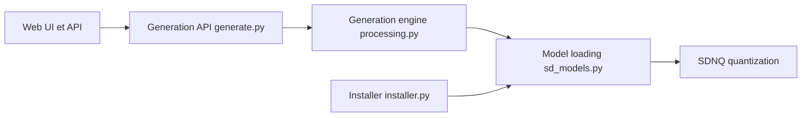

# vladmandic/sdnext

> WebUI and server for image and video generation based on Stable Diffusion and many diffusion models.

## The problem
Running large diffusion models on varied hardware with a single interface.

## What it actually does
Automatically downloads models, generates images/videos, does img2img, ControlNet, LoRA, upscaling, captioning and tagging (25+ LLM/VLM models). SDNQ quantizes on the fly (up to 4× less VRAM) and Balanced Offload splits work between CPU and GPU. Installer with updates, ~15 languages.

## How it is wired


## Trying it
```bash
git clone https://github.com/vladmandic/sdnext
cd sdnext
./webui.sh
```

## Cost and gotchas
GPU recommended (NVIDIA, AMD, Intel Arc, Apple, DirectML…); large model downloads. Platform guides are external to the README.

## What it is not
Not a hosting service: everything runs locally. Codebase derived from Automatic1111.

## Alternatives
Cites AUTOMATIC1111 as the origin of the code.

## For you
Worth watching: a good testbed for local diffusion, if you have a GPU; depends heavily on a single maintainer.
