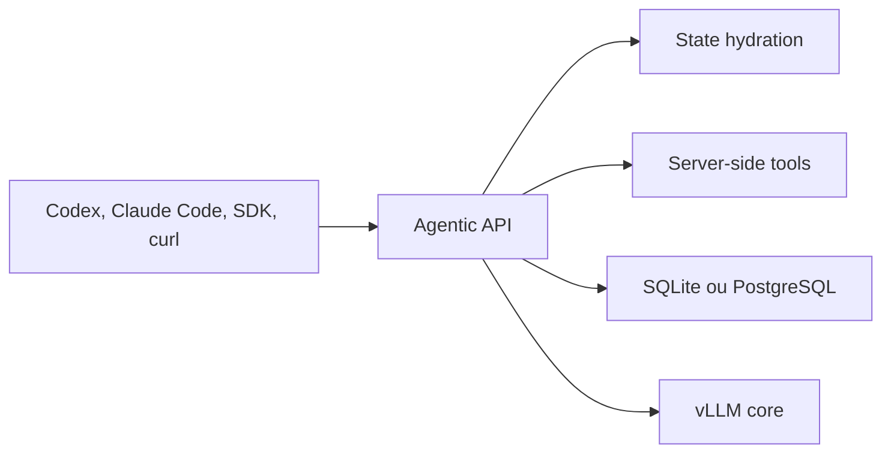

# vllm-project/agentic-api

> Rust gateway in front of vLLM that manages conversation state and tools server-side, for hosting agents on your own GPUs.

## The problem
Agentic applications need conversation state and tool loops, which clutter client code and which vLLM alone does not provide.

## What it actually does
A gateway exposes the OpenAI-compatible Responses API and Anthropic's Messages API. It rehydrates history via `previous_response_id`, runs web search (You.com, Brave, Tavily, Serply, SearXNG), MCP and an optional code interpreter server-side, and persists in SQLite or PostgreSQL. A CLI launches Codex or Claude Code on a model served by vLLM.

## How it is wired


## Trying it
```bash
cargo build -p agentic-server --bins
./target/debug/agentic run codex --model Qwen/Qwen3-30B-A3B-FP8

uvx --from agentic-api==0.9.0 agentic serve --upstream http://existing-vllm:8000
```

## Cost and gotchas
You need a vLLM server on GPU, or an existing upstream. Web search requires a provider key, except self-hosted SearXNG. Building requires a Rust toolchain, which is not in the list of prerequisites. The README is truncated in this block, in the search providers section.

## What it is not
Not an inference engine: vLLM is still required. Stateful Messages and the Interactions API are still planned. The wheels cover Linux x86_64 and macOS, not Windows.

## Alternatives
No alternative named in the README.

## For you
Worth watching: exactly the missing link for running Codex or Claude Code on open models served by vLLM, but the repo dates from March 2026 and is still young.
