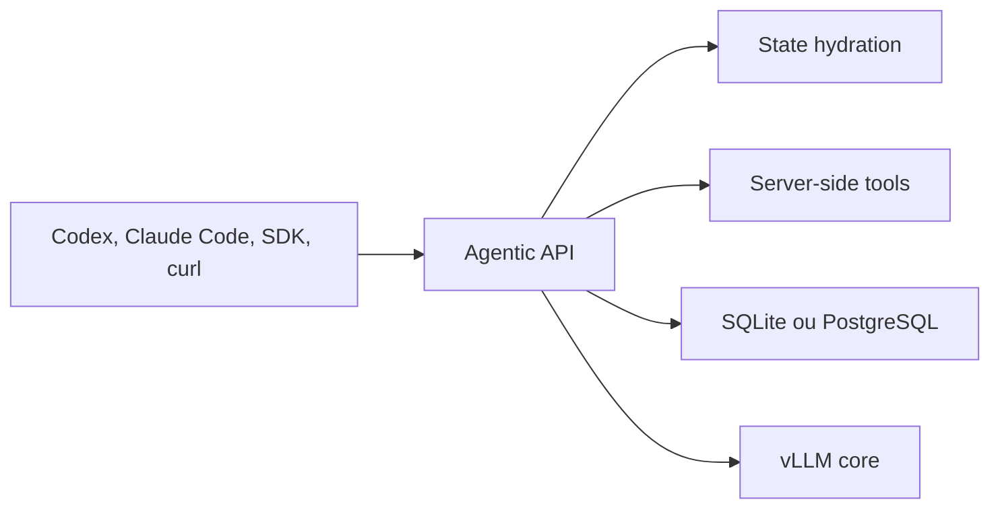

# vllm-project/agentic-api

> Passerelle Rust devant vLLM qui gère l'état des conversations et les outils côté serveur, pour héberger des agents sur ses propres GPU.

## Le problème
Les applications agentiques ont besoin d'état de conversation et de boucles d'outils, qui encombrent le code client et que vLLM seul ne fournit pas.

## Ce que ça fait vraiment
Une passerelle expose l'API Responses compatible OpenAI et l'API Messages d'Anthropic. Elle réhydrate l'historique par `previous_response_id`, exécute côté serveur la recherche web (You.com, Brave, Tavily, Serply, SearXNG), MCP et un interpréteur de code optionnel, et persiste en SQLite ou PostgreSQL. Un CLI lance Codex ou Claude Code sur un modèle servi par vLLM.

## Comment c'est branché


## Essayer
```bash
cargo build -p agentic-server --bins
./target/debug/agentic run codex --model Qwen/Qwen3-30B-A3B-FP8

uvx --from agentic-api==0.9.0 agentic serve --upstream http://existing-vllm:8000
```

## Coût et pièges
Il faut un serveur vLLM sur GPU, ou un amont existant. La recherche web demande la clé d'un fournisseur, sauf SearXNG auto-hébergé. La compilation demande une chaîne Rust, ce qui n'existe pas dans la liste des prérequis. Le README est tronqué dans ce bloc, dans la section des fournisseurs de recherche.

## Ce que ce n'est pas
Pas un moteur d'inférence : vLLM reste nécessaire. Messages avec état et Interactions API sont encore planifiés. Les wheels couvrent Linux x86_64 et macOS, pas Windows.

## Alternatives
Aucune alternative nommée dans le README.

## Pour toi
À surveiller : exactement le chaînon manquant pour faire tourner Codex ou Claude Code sur des modèles ouverts servis par vLLM, mais le dépôt date de mars 2026 et reste jeune.

