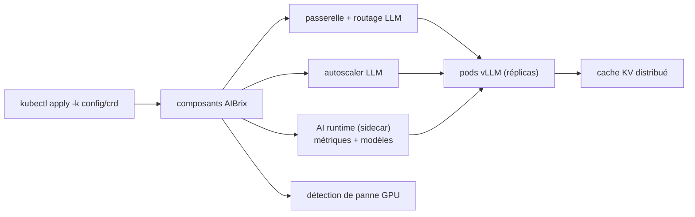

# vllm-project/aibrix

> Kubernetes control plane for serving LLMs with vLLM at enterprise scale.

## The problem
vLLM serves a model on one machine; routing traffic between replicas, autoscaling on real load,
pooling the KV cache and detecting a failing card are outside its scope.

## What it actually does
Provides the building blocks of an inference infrastructure: dense LoRA management, LLM gateway and routing
across models and replicas, an autoscaler tailored to LLM applications, a unified sidecar runtime
(metrics standardization, model download and management), multi-node distributed inference,
a distributed KV cache reusable across engines, heterogeneous serving at controlled cost with
SLO guarantees, and proactive detection of GPU hardware failures. Shipped as CRDs + components
installed with `kubectl apply`, with CRDs kept separate from the operator so that an uninstall does not delete
user resources.

## How it is wired


## Trying it
```bash
git clone https://github.com/vllm-project/aibrix.git && cd aibrix
kubectl apply -k config/dependency --server-side
kubectl apply -k config/crd --server-side
kubectl apply -k config/default
kubectl apply -f "https://github.com/vllm-project/aibrix/releases/download/v0.7.0/aibrix-dependency-v0.7.0.yaml" --server-side
kubectl apply -f "https://github.com/vllm-project/aibrix/releases/download/v0.7.0/aibrix-core-crds-v0.7.0.yaml" --server-side
kubectl apply -f "https://github.com/vllm-project/aibrix/releases/download/v0.7.0/aibrix-core-v0.7.0.yaml"
```

## Cost and gotchas
Free, but assumes a Kubernetes cluster with GPUs and the corresponding ops. Two installation
channels (nightly via kustomize, stable via release YAML): mixing the two is the obvious trap. The README
defers the real configuration to the external documentation.

## What it is not
Not an inference engine: it is the layer above vLLM, which remains required. Not a
"quickstart" usable as is: the README only shows installation, with no example of
model deployment or request.

## Alternatives
No alternative named in the README.

## For you
The reference to know if you ever have to serve several LLMs on K8s; heavy otherwise.
