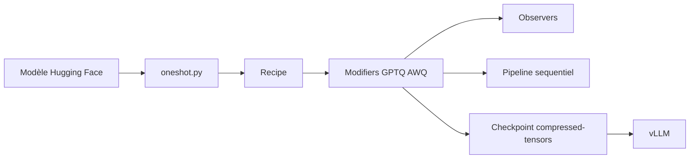

# vllm-project/llm-compressor

> Python library to quantize Hugging Face models and serve them with vLLM.

## The problem
A full-precision LLM costs too much GPU memory; quantizing properly requires algorithms and an output format the server can read.

## What it actually does
You load a model, choose a recipe (for example `QuantizationModifier` in FP8) and then call `oneshot`. The algorithms cover GPTQ, AWQ, AutoRound, SmoothQuant, SparseGPT, and quantization of activations, KV cache and attention (INT4, FP8, NVFP4, MXFP4). The model is saved in the `compressed-tensors` format, read by vLLM. A "model-definition-free" path exists, and calibration can be distributed (DDP, disk offload).

## How it is wired


## Trying it
```bash
pip install llmcompressor
pip install vllm
```
```python
from llmcompressor import oneshot
from llmcompressor.modifiers.quantization import QuantizationModifier
recipe = QuantizationModifier(targets="Linear", scheme="FP8_BLOCK", ignore=["lm_head", "re:.*mlp.gate$"])
oneshot(model=model, recipe=recipe)
```

## Cost and gotchas
The model must fit in memory for calibration, unless offload or DDP is used; a GPU is needed in practice. The README's "news" section cites many checkpoints and gains measured by the team, not verified here.

## What it is not
Not an inference server: it produces files, vLLM runs them. It does not guarantee quality after quantization: each checkpoint must be evaluated.

## Alternatives
No alternative is named in the README.

## For you
Adopt if you deploy on vLLM: Apache-2.0, pushed in September 2026, format read directly by the target server.
