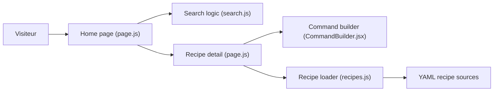

# vllm-project/recipes

> Community recipes for serving a given model on given hardware with vLLM, with a command generator.

## The problem
Knowing which vLLM options to use for a given model on a given GPU means digging through issues and forums.

## What it actually does
Catalog of guides by vendor (DeepSeek, Qwen, Llama, GLM, Mistral, Kimi, gpt-oss, Gemma, etc.). The site (Next.js) lets you search, open a model page, choose options and copy the generated command. A full-text feed of the recipes exists. The old MkDocs guides remain for reference.

## How it is wired


## Trying it
```bash
uv venv
source .venv/bin/activate
uv pip install -r requirements.txt
uv run mkdocs serve --dev-addr 127.0.0.1:8001
```

## Cost and gotchas
Free, but serving these models requires GPUs. The command given in the README previews the old guides, not the new site. 183 open issues.

## What it is not
Not an inference server: these are configuration recipes. They may age with vLLM versions.

## Alternatives
No alternative named in the README.

## For you
Adopt if you serve LLMs with vLLM: direct time saver, project of the vLLM organization, recent activity.
