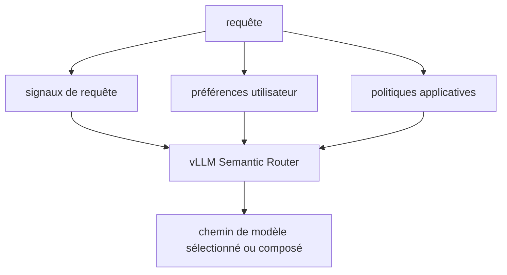

# vllm-project/semantic-router

> Programmable routing layer that picks the right model for each LLM request.

## The problem
The "best" model changes depending on the user, the load, where the data lives and the budget.
Hard-coding that choice in the application freezes a decision that should remain a policy.

## What it actually does
It evaluates request signals, user preferences and application policies to select — or compose — a model path per request.
It covers four stated axes: composing paths across specialized models, routing across heterogeneous compute (GPU, accelerators, edge, cloud), keeping data within its boundary, making every preference executable.
The declared goal is to act on quality, cost, latency, privacy and safety without writing routing logic in the application.
An online playground is offered with public read credentials.

## How it is wired


## Trying it
```bash
curl -fsSL https://vllm-sr.ai/install.sh | bash -s -- --channel stable
```
The README points to the installation guide for pip, uv or agent-driven installation, without giving those commands.

## Cost and gotchas
Installation goes through a `curl | bash` script on a third-party domain. The public playground shares a read-only account, with credentials in clear text in the README.
Nothing is said about the resources required or about what per-request signal evaluation costs.

## What it is not
It is not an inference engine: it routes to vLLM and the like, it does not serve models.
And this README is not enough to judge: it stops at the playground, with no architecture, no configuration, no license — insufficient material.

## Alternatives
No alternative is named in the README.

## For you
The subject (Mixture-of-Models, routing policies) is exactly yours, but the README does not say enough to decide.
