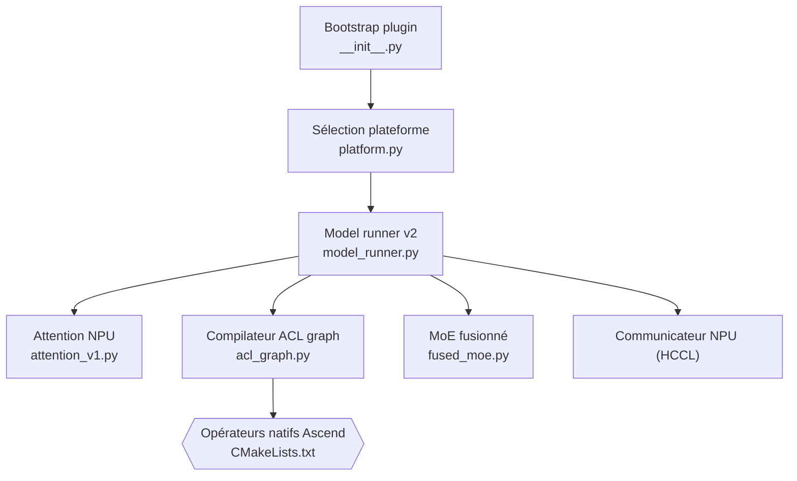

# vllm-project/vllm-ascend

> Community hardware plugin that lets vLLM run on Huawei Ascend NPUs.

## The problem
vLLM natively targets the GPU; without adaptation, it cannot use the Ascend NPU accelerator found in Chinese or specialized deployments.

## What it actually does
Provides the Ascend execution paths for vLLM workers (runner v1 and v2, Ascend 310P compatibility), attention (standard, MLA, sparse, FA3, context-parallel), ACL graph compilation, fused MoE, quantization, and KV-cache transfer/offloading via HCCL.

## How it is wired

## Trying it
No installation/usage command is documented in the available excerpt: the README mostly lists the hardware and software prerequisites (Python 3.12, CANN 9.2.1, PyTorch/TorchNPU 2.10.0).

## Cost and gotchas
Requires real Ascend NPU hardware (Atlas 800I/300I), not a standard GPU, plus precise versions of CANN and PyTorch/TorchNPU: a heavy and specific constraint.

## What it is not
Not a fork of vLLM: it is a plugin that attaches to it. Does not work without access to Ascend NPU hardware, which is out of reach for most users.

## Alternatives
No alternative named in the README (the repository mentions vLLM itself as the parent project, not as an alternative).

## For you
Worth watching only if your MLOps infrastructure depends on Huawei Ascend hardware; otherwise of no immediate practical interest.
