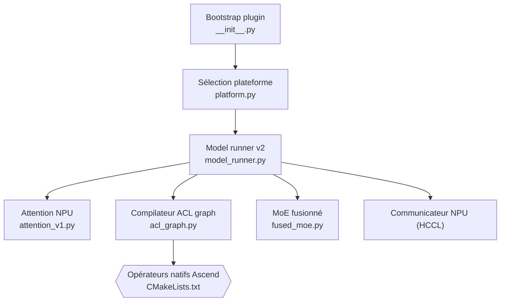

# vllm-project/vllm-ascend

> Plugin matériel communautaire qui permet d'exécuter vLLM sur les NPU Huawei Ascend.

## Le problème
vLLM cible nativement le GPU ; sans adaptation, il ne peut pas utiliser l'accélérateur Ascend NPU des déploiements chinois ou spécialisés.

## Ce que ça fait vraiment
Fournit les chemins d'exécution Ascend pour les workers vLLM (runner v1 et v2, compatibilité Ascend 310P), l'attention (standard, MLA, sparse, FA3, context-parallel), la compilation de graphe ACL, le MoE fusionné, la quantification, et le transfert/déchargement de KV-cache via HCCL.

## Comment c'est branché

## Essayer
Aucune commande d'installation/usage n'est documentée dans l'extrait disponible : le README liste surtout les prérequis matériels et logiciels (Python 3.12, CANN 9.2.1, PyTorch/TorchNPU 2.10.0).

## Coût et pièges
Nécessite du matériel Ascend NPU (Atlas 800I/300I) réel, pas un GPU standard, plus des versions précises de CANN et PyTorch/TorchNPU : contrainte lourde et spécifique.

## Ce que ce n'est pas
Pas un fork de vLLM : c'est un plugin qui s'y greffe. Ne fonctionne pas sans accès à du matériel Ascend NPU, inaccessible à la majorité des utilisateurs.

## Alternatives
Aucune alternative nommée dans le README (le dépôt évoque vLLM lui-même comme projet parent, pas comme alternative).

## Pour toi
À surveiller seulement si ton infrastructure MLOps dépend de matériel Huawei Ascend ; sinon sans intérêt pratique immédiat.

