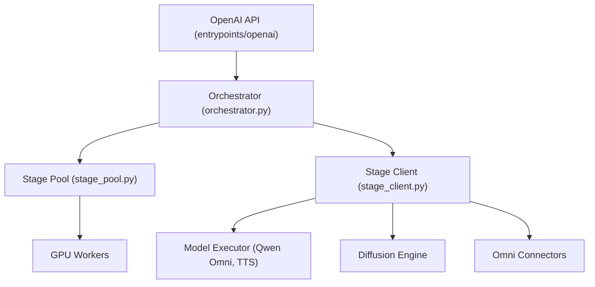

# vllm-project/vllm-omni

> vLLM extension for serving omni-modal models (text, image, audio, video, action) through an OpenAI API.

## The problem
vLLM mostly serves autoregressive text; diffusion, speech or multi-stage models need a different serving engine.

## What it actually does
The framework splits a model into stages (for example "thinker", "talker", diffusion) run by workers, with KV and data transfer between stages through connectors (shared memory, Mooncake…). It covers families such as Qwen3-Omni, TTS, Wan2.2 or action models. It exposes an OpenAI-compatible API, full-duplex real time, quantization, and CUDA, ROCm, NPU and XPU platforms.

## How it is wired

## Trying it
No command documented in the README: it points to the documentation (installation, quickstart) and to nightly CUDA Docker images.

## Cost and gotchas
Free but requires GPU (or NPU) hardware and pinning to a specific vLLM version (0.32.0 is aligned with vLLM 0.32.0). 1,913 open issues: the project moves fast.

## What it is not
Not a model nor a hosted service: it is a serving runtime. Nor is it a replacement for vLLM, it builds on it.

## Alternatives
No alternative cited in the README.

## For you
Worth watching if you already serve models with vLLM and want audio, image or video; otherwise the GPU setup is heavy.
