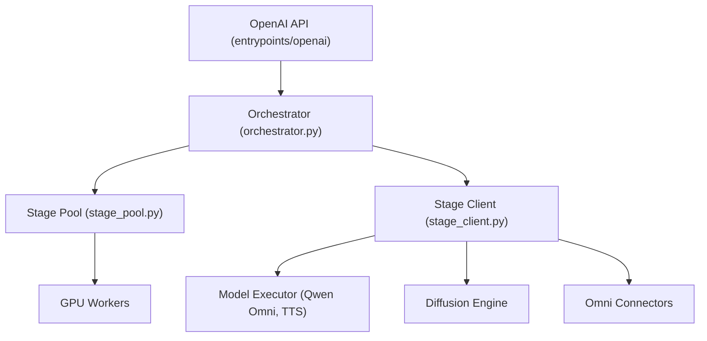

# vllm-project/vllm-omni

> Extension de vLLM pour servir des modèles omni-modaux (texte, image, audio, vidéo, action) via API OpenAI.

## Le problème
vLLM sert surtout du texte autorégressif ; les modèles de diffusion, de parole ou multi-étapes demandent un autre moteur de service.

## Ce que ça fait vraiment
Le framework découpe un modèle en étapes (par exemple « thinker », « talker », diffusion) exécutées par des workers, avec transfert de KV et de données entre étapes via des connecteurs (mémoire partagée, Mooncake…). Il couvre des familles comme Qwen3-Omni, TTS, Wan2.2 ou des modèles d'action. Il expose une API compatible OpenAI, du temps réel full-duplex, la quantification, et des plateformes CUDA, ROCm, NPU, XPU.

## Comment c'est branché

## Essayer
Aucune commande documentée dans le README : il renvoie à la documentation (installation, quickstart) et à des images Docker CUDA nocturnes.

## Coût et pièges
Gratuit mais exige du matériel GPU (ou NPU) et le calage sur une version précise de vLLM (la 0.32.0 est alignée sur vLLM 0.32.0). 1 913 issues ouvertes : le projet bouge vite.

## Ce que ce n'est pas
Pas un modèle ni un service hébergé : c'est un runtime de service. Ce n'est pas non plus un remplaçant de vLLM, il s'appuie dessus.

## Alternatives
Aucune alternative citée dans le README.

## Pour toi
À surveiller si tu sers déjà des modèles avec vLLM et veux de l'audio, de l'image ou de la vidéo ; sinon l'installation GPU est lourde.

