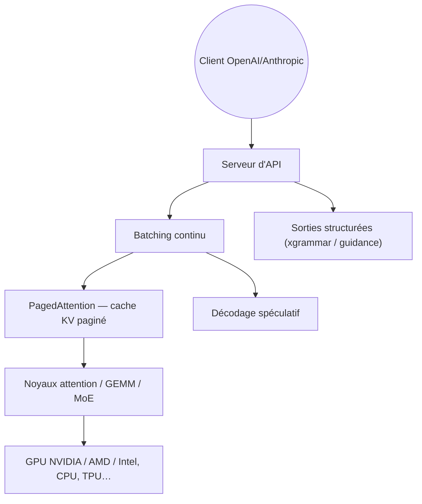

# vllm-project/vllm

> High-speed LLM inference service engine, developed at the Sky Computing Lab at Berkeley.

## The problem
Serving a large language model (LLM) to multiple users saturates the GPU memory and reduces throughput.
The attention cache memory becomes fragmented and wasted if it is allocated naively.

## What it actually does
PagedAttention manages key/value memory on a page-by-page basis, similar to system memory paging.
Continuous batching of requests, segmented prefilling, prefix caching, partial or complete CUDA/HIP graphs.
FP8, MXFP8/MXFP4, NVFP4, INT8, INT4, GPTQ/AWQ, GGUF, compressed-tensors, TorchAO quantization.
Speculative decoding (n-gram, suffix, EAGLE, DFlash); tensor parallelism, pipelining, data, experts, context.
OpenAI-compatible server, plus Anthropic Messages API and gRPC; support for 200+ Hugging Face architectures.

## How it is wired


## Trying it
```bash
uv pip install vllm
```

## Cost and gotchas
Free. The cost is the hardware: a GPU with enough VRAM for the model and its KV cache.

The hardware plugins (TPU, Gaudi, Ascend, Apple Silicon) are not all at the same level of maturity.

## What it is not
Not a desktop tool: installation and configuration are more complex than a simple local runtime.
Not a template provider or a chat interface – it is a service engine.
Quantization reduces memory usage but changes the quality; nothing here evaluates it for you.

## Alternatives
- `ollama/ollama`: simpler, for single-user use on a machine.

## For you
The default option when serving a model that can be accessed by multiple users. This is a recommended approach.
