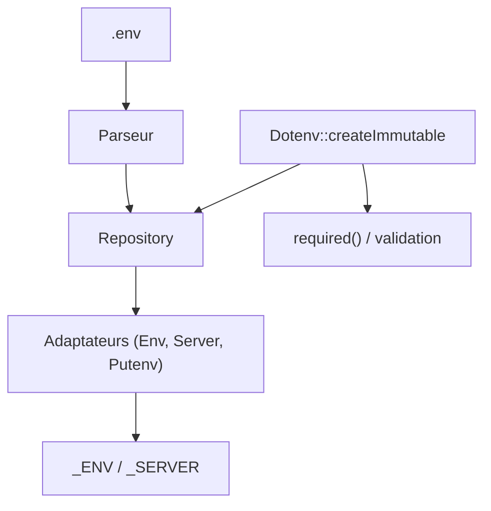

# vlucas/phpdotenv

> A PHP library that loads a `.env` file into `$_ENV` and `$_SERVER`, to separate configuration from code.

## The problem
Credentials and settings that change depending on the environment end up hard-coded in the code.

## What it actually does
Reads a `.env` file and fills `$_ENV`, `$_SERVER` and, optionally, `getenv()`. It handles quotes, escapes, nested variables, comments, multiple files, immutability of existing variables, an allow list and validation (presence, non-empty, integer, boolean, allowed values, regex).

## How it is wired


## Trying it
```bash
composer require vlucas/phpdotenv
```
```php
$dotenv = Dotenv\Dotenv::createImmutable(__DIR__);
$dotenv->load();
```

## Cost and gotchas
Free, BSD-3-Clause license. You need PHP and Composer. Never add `.env` to the Git repository. `getenv()` and `putenv()` are discouraged because they are not thread-safe.

## What it is not
Not a secrets vault: the `.env` file stays in plain text. Not a tool outside the PHP ecosystem.

## Alternatives
- The README cites the original Ruby dotenv (bkeepers/dotenv), of which this is the PHP version.

## For you
Ignore: only useful in PHP; in Python, you would use the dotenv equivalent of your language.
