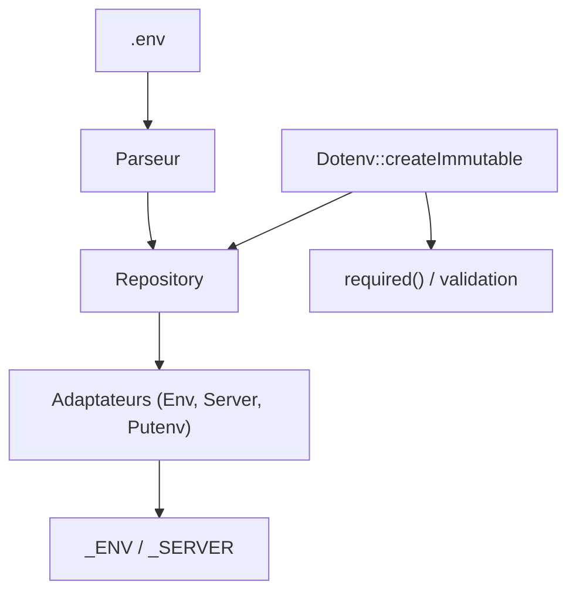

# vlucas/phpdotenv

> Bibliothèque PHP qui charge un fichier `.env` dans `$_ENV` et `$_SERVER`, pour séparer configuration et code.

## Le problème
Les identifiants et réglages qui changent selon l'environnement se retrouvent écrits en dur dans le code.

## Ce que ça fait vraiment
Lit un fichier `.env` et remplit `$_ENV`, `$_SERVER` et, en option, `getenv()`. Elle gère les guillemets, les échappements, les variables imbriquées, les commentaires, les fichiers multiples, l'immutabilité des variables existantes, une liste d'autorisation et la validation (présence, non vide, entier, booléen, valeurs permises, regex).

## Comment c'est branché


## Essayer
```bash
composer require vlucas/phpdotenv
```
```php
$dotenv = Dotenv\Dotenv::createImmutable(__DIR__);
$dotenv->load();
```

## Coût et pièges
Gratuit, licence BSD-3-Clause. Il faut PHP et Composer. N'ajoute jamais `.env` au dépôt Git. `getenv()` et `putenv()` sont déconseillés car non sûrs en multithread.

## Ce que ce n'est pas
Pas un coffre-fort de secrets : le fichier `.env` reste en clair. Pas un outil hors de l'écosystème PHP.

## Alternatives
- Le README cite l'original Ruby dotenv (bkeepers/dotenv), dont celle-ci est la version PHP.

## Pour toi
À ignorer : ne sert qu'en PHP ; en Python, tu utiliseras l'équivalent dotenv de ton langage.

