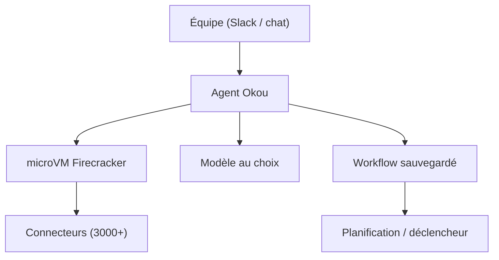

# vm0-ai/vm0

> A team agent (Okou) that runs business tasks via Slack, Gmail or GitHub, inside isolated microVMs.

## The problem
Teams repeat cross-cutting tasks (reports, ticket triage, drafts) without being able to hand them to a supervised agent. Each automation stays tied to one person.

## What it actually does
You mention the agent like a colleague; it picks its tools and runs the task, one conversation per task, in parallel. A repeated workflow can be saved, shared with the workspace and scheduled. Each run executes in a Firecracker microVM, with per-tool permissions. Anything leaving the company (email, ad budget) stays a draft until human approval.

## How it is wired
Simplified diagram based on the fiche, no diagram provided.



## Trying it
```bash
# Aucune commande d'installation n'est documentée dans le README fourni.
```

## Cost and gotchas
Model providers (Anthropic, OpenAI, DeepSeek, Google) are your choice, so their keys and bills are on you. The README details neither self-hosted installation nor pricing: not documented.

## What it is not
Not an agent framework to embed in your code: it is a product aimed at non-technical teams. It sends nothing without human approval. A license is present but not identified by GitHub.

## Alternatives
No alternative named in the README.

## For you
Worth watching: the idea of shared workflows with individual permissions and microVMs is interesting for MLOps, but installation and license are not established.
