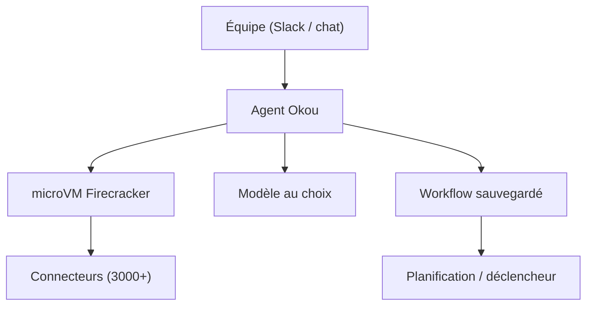

# vm0-ai/vm0

> Un agent d'équipe (Okou) qui exécute des tâches métier via Slack, Gmail ou GitHub, dans des microVM isolées.

## Le problème
Les équipes répètent des tâches transverses (rapports, tri de tickets, brouillons) sans pouvoir les confier à un agent encadré. Chaque automatisation reste liée à une personne.

## Ce que ça fait vraiment
On mentionne l'agent comme un collègue ; il choisit ses outils et exécute la tâche, une conversation par tâche, en parallèle. Un workflow répété peut être sauvegardé, partagé au workspace et planifié. Chaque exécution tourne dans une microVM Firecracker, avec des permissions par outil. Tout ce qui sort de l'entreprise (mail, budget publicitaire) reste en brouillon jusqu'à validation humaine.

## Comment c'est branché
Schéma simplifié d'après la fiche, sans diagramme fourni.



## Essayer
```bash
# Aucune commande d'installation n'est documentée dans le README fourni.
```

## Coût et pièges
Les fournisseurs de modèles (Anthropic, OpenAI, DeepSeek, Google) sont à choisir, donc leurs clés et leur facture sont à ta charge. Le README ne détaille ni l'installation auto-hébergée ni les tarifs : non documenté.

## Ce que ce n'est pas
Pas un framework d'agents à intégrer dans son code : c'est un produit orienté équipes non techniques. Il n'envoie rien sans accord humain. La licence est présente mais non identifiée par GitHub.

## Alternatives
Aucune alternative nommée dans le README.

## Pour toi
À surveiller : l'idée de workflows partagés avec permissions individuelles et microVM est intéressante pour du MLOps, mais l'installation et la licence ne sont pas établies.

