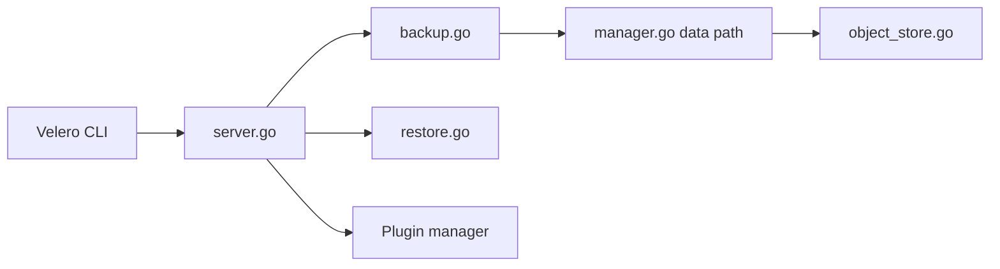

# vmware-tanzu/velero

> Tool for backing up, restoring and migrating the resources and volumes of a Kubernetes cluster.

## The problem
Losing a cluster or having to copy it to another one without a consistent backup of resources and persistent volumes.

## What it actually does
A server in the cluster and a local CLI. Backs up and restores resources and volumes, schedules, calls restore hooks, moves volume data to object storage through plugins. Also used to migrate or replicate a cluster to dev/test.

## How it is wired

## Trying it
No command in the README: it points to velero.io/docs.

## Cost and gotchas
Free; the destination object storage is on you. Check the compatibility matrix against your Kubernetes version. 796 open issues.

## What it is not
Not an application database backup. The upgrade test covers only n-2 minor versions.

## Alternatives
No alternative named in the README.

## For you
Adopt if your ML platforms run on Kubernetes: CNCF project (sandbox), Apache-2.0, maintained.
