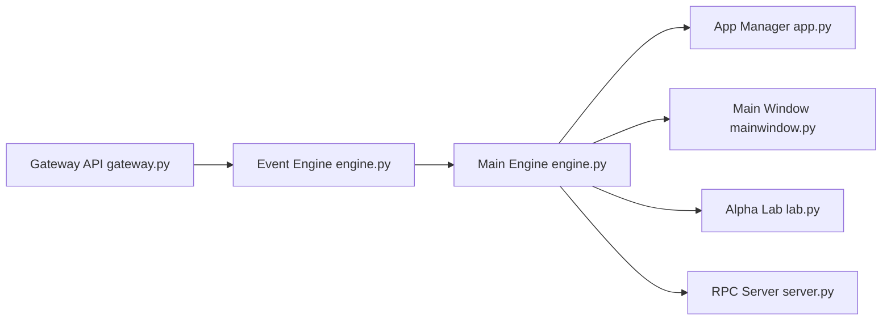

# vnpy/vnpy

> Python quantitative trading framework (VeighNa) with a machine learning research module, for traders and quants.

## The problem
Plugging brokers, data sources and strategies into a single trading system takes a lot of custom code, especially on Chinese markets.

## What it actually does
An event-driven core (`EventEngine` and `MainEngine`) connects broker gateways, data sources, databases (SQLite, MySQL, PostgreSQL, MongoDB…) and a Qt interface. Applications plug into it: CTA strategies, backtesting, options, execution algos, risk management, RPC. The `vnpy.alpha` module chains factors (Alpha 158), models (Lasso, LightGBM, MLP), strategy and backtest. Broker connectors are separate packages.

## How it is wired


## Trying it
```bash
bash install.sh          # Ubuntu ; install.bat sous Windows
python run.py
ruff check .
mypy vnpy
```

## Cost and gotchas
Free; Python 3.10+ (3.13 recommended), Windows 11+ or Ubuntu 22.04+. You need a CTP simulation account (SimNow) and a VeighNa forum account; data feeds (RQData, Wind, iFinD…) are third-party services, often paid. The README is in Chinese.

## What it is not
Not a turnkey system for making money: the README's warnings concern adapting the modules. The core assumes the listed markets and brokers, mostly Chinese.

## Alternatives
- Qlib: inspires `vnpy.alpha`, focused on ML research without live trading.

## For you
Worth watching: `vnpy.alpha` (factors, LightGBM, notebooks) is instructive for an ML profile on financial time series, but the whole remains oriented toward Chinese markets.
