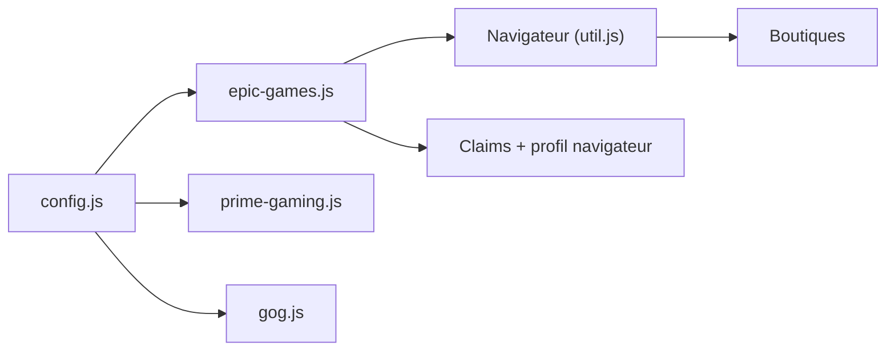

# vogler/free-games-claimer

> Playwright scripts that periodically claim the free games from Epic, Prime Gaming, GOG and Unreal Engine.

## The problem
Free games change every week or month; claiming them by hand is repetitive.

## What it actually does
Node scripts (`epic-games`, `prime-gaming`, `gog`, `unrealengine`) drive a Firefox through Playwright, log in to each store (credentials, optional OTP), spot the free offers and add them to your account. Claims and keys are recorded in `data/`, with screenshots, and notifications go out via Apprise. You have to schedule the execution yourself (cron, Windows task, Compose).

## How it is wired


## Trying it
```bash
docker run --rm -it -p 6080:6080 -v fgc:/fgc/data --pull=always ghcr.io/vogler/free-games-claimer
node epic-games
```

## Cost and gotchas
Free, but you entrust credentials and OTP keys to a script; the README warns about the risk of plain text. Epic captchas in Docker (issue cited), possible violation of the stores' terms of use, 142 open issues. AGPL-3.0 license.

## What it is not
Not a safe tool for an important account. Nothing to do with data or AI.

## Alternatives
Not documented in the README (it cites epicgames-freebies-claimer as an abandoned tool).

## For you
Ignore: outside your scope, and automating account logins carries a real risk of being blocked.
