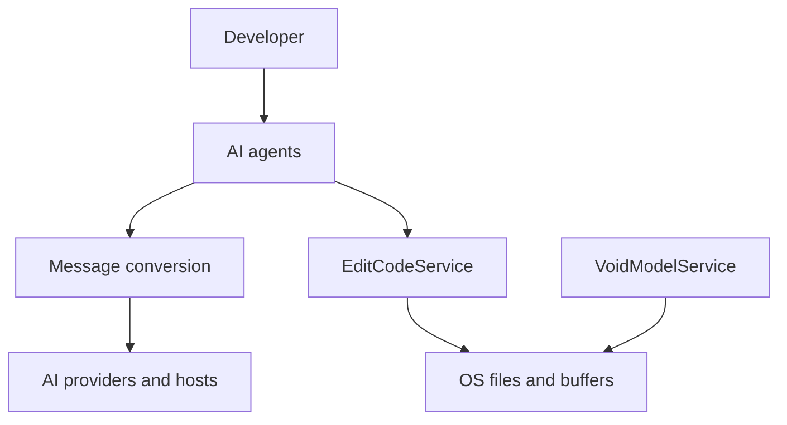

# voideditor/void

> Code editor, a VS Code fork, with AI agents; abandoned but kept as a reference.

## The problem
Using AI agents in the editor with any model, without going through an intermediary server.

## What it actually does
A VS Code fork that sends messages directly to providers, offering agents, checkpoints and streamed diffs (EditCodeService, VoidModelService). The README declares the project deprecated, with no contributions, and points to forks.

## How it is wired

## Trying it
No command documented in the README (older versions can be downloaded from the Releases page).

## Cost and gotchas
Free; models at your expense or local. Archived and deprecated project: no updates.

## What it is not
It is no longer a maintained editor. Its current value is documentary, for anyone forking VS Code.

## Alternatives
The README points to "Void Forks" (a list of more recent forks).

## For you
Ignore as an editor: deprecated and archived; read it only to understand how to fork VS Code.
