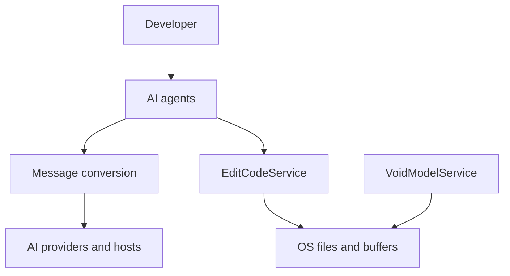

# voideditor/void

> Éditeur de code, fork de VS Code, avec agents IA ; abandonné mais conservé comme référence.

## Le problème
Utiliser des agents IA dans l'éditeur avec n'importe quel modèle, sans passer par un serveur intermédiaire.

## Ce que ça fait vraiment
Fork de VS Code qui envoie les messages directement aux fournisseurs, propose agents, points de contrôle et diffs en flux continu (EditCodeService, VoidModelService). Le README déclare le projet déprécié, sans contributions, et renvoie vers des forks.

## Comment c'est branché

## Essayer
Aucune commande documentée dans le README (téléchargement des versions anciennes via la page Releases).

## Coût et pièges
Gratuit ; modèles à ta charge ou en local. Projet archivé et déprécié : pas de mises à jour.

## Ce que ce n'est pas
Ce n'est plus un éditeur suivi. Sa valeur actuelle est documentaire pour qui forke VS Code.

## Alternatives
Le README renvoie vers « Void Forks » (liste de forks plus récents).

## Pour toi
À ignorer comme éditeur : déprécié et archivé ; ne le lire que pour comprendre comment forker VS Code.

