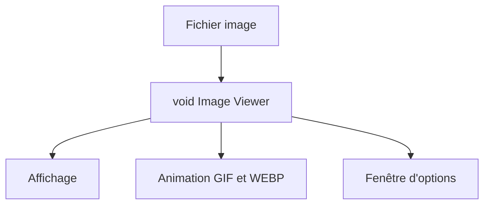

# voidtools/voidImageViewer

> Lightweight image viewer for Windows, with faithful playback of animated GIF and WEBP files.

## The problem
Quickly open an image, animated or not, without launching heavy software.

## What it actually does
Displays BMP, GIF, ICO, PNG, JPG, TIF and WEBP. Animated GIF and WEBP files are replayed as accurately as possible. The README shows three options windows: general, view and commands. That is all the README says.

## How it is wired
Simplified diagram based on the fiche, no diagram provided.

## Trying it
No documented command: download from the repository's releases page.

## Cost and gotchas
Free, no account. Windows only. The license is present but not identified by GitHub: read it before any use beyond personal use.

## What it is not
Not an editor nor a photo manager: only a viewer.

## Alternatives
No alternative named in the README.

## For you
Ignore: a simple Windows viewer unrelated to data or AI, and the README is too thin to say more.
