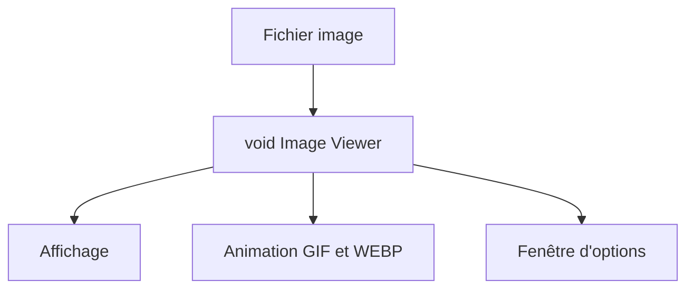

# voidtools/voidImageViewer

> Visionneuse d'images légère pour Windows, avec lecture fidèle des GIF et WEBP animés.

## Le problème
Ouvrir vite une image, animée ou non, sans lancer un logiciel lourd.

## Ce que ça fait vraiment
Affiche BMP, GIF, ICO, PNG, JPG, TIF et WEBP. Les GIF et WEBP animés sont rejoués le plus précisément possible. Le README montre trois fenêtres d'options : général, affichage et commandes. C'est tout ce que dit le README.

## Comment c'est branché
Schéma simplifié d'après la fiche, sans diagramme fourni.

## Essayer
Aucune commande documentée : télécharger depuis la page des releases du dépôt.

## Coût et pièges
Gratuit, sans compte. Windows uniquement. La licence est présente mais non identifiée par GitHub : à lire avant tout usage hors personnel.

## Ce que ce n'est pas
Pas un éditeur ni un gestionnaire de photos : seulement un afficheur.

## Alternatives
Aucune alternative nommée dans le README.

## Pour toi
À ignorer : simple visionneuse Windows sans rapport avec la data ou l'IA, et README trop mince pour en dire davantage.

