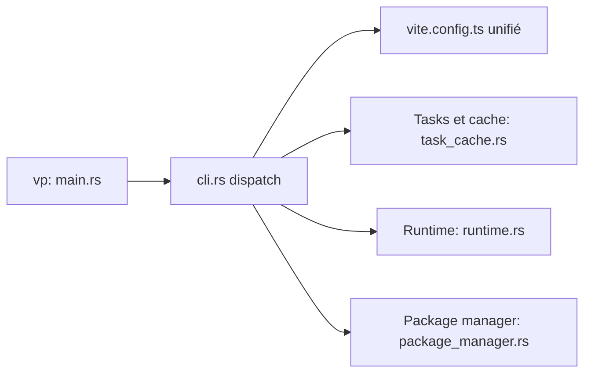

# voidzero-dev/vite-plus

> Unified web toolchain `vp`: runtime, package management, dev, lint, test, build and monorepo tasks.

## The problem
Assembling Vite, Vitest, a linter, a formatter, a bundler and a Node version manager in separate configs.

## What it actually does
A single `vp` binary bundles Vite, Vitest, Oxlint, Oxfmt, Rolldown, tsdown and Vite Task. Single configuration in `vite.config.ts`. Commands: `vp env`, `install`, `dev`, `check`, `test`, `build`, `run` (task cache), `pack`, `create`, `migrate`. Wraps pnpm, npm, Yarn or Bun.

## How it is wired


## Trying it
```bash
curl -fsSL https://vite.plus | bash
vp create
vp migrate
```

## Cost and gotchas
Free, MIT. Installed through `curl | bash`. Manual migration requires precise `overrides` for `vite` and `vitest`.

## What it is not
Not a front-end framework. Maturity is not declared in the README.

## Alternatives
No alternative named.

## For you
Watch: only if you build web interfaces around your models; otherwise no effect.
