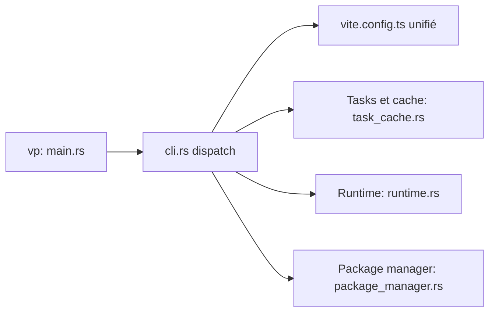

# voidzero-dev/vite-plus

> Chaîne d'outils web unifiée `vp` : runtime, gestion de paquets, dev, lint, test, build et tâches monorepo.

## Le problème
Assembler Vite, Vitest, linter, formateur, bundler et gestionnaire de versions Node en configs séparées.

## Ce que ça fait vraiment
Un binaire `vp` regroupe Vite, Vitest, Oxlint, Oxfmt, Rolldown, tsdown et Vite Task. Configuration unique dans `vite.config.ts`. Commandes : `vp env`, `install`, `dev`, `check`, `test`, `build`, `run` (cache de tâches), `pack`, `create`, `migrate`. Enveloppe pnpm, npm, Yarn ou Bun.

## Comment c'est branché


## Essayer
```bash
curl -fsSL https://vite.plus | bash
vp create
vp migrate
```

## Coût et pièges
Gratuit, MIT. Installation par `curl | bash`. La migration manuelle exige des `overrides` précis pour `vite` et `vitest`.

## Ce que ce n'est pas
Pas un framework front. La maturité n'est pas déclarée dans le README.

## Alternatives
Aucune alternative nommée.

## Pour toi
Surveiller : seulement si tu bâtis des interfaces web autour de tes modèles ; sinon sans effet.

