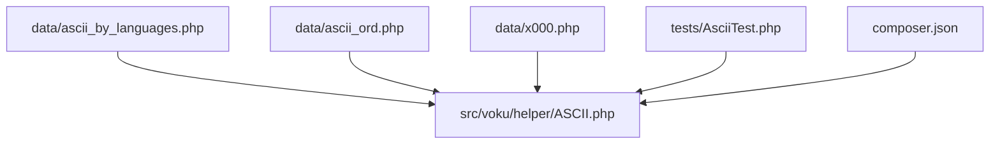

# voku/portable-ascii

> Dependency-free PHP library to transliterate and clean text into ASCII.

## The problem
Converting Unicode text to ASCII (slugs, file names) often depends on PHP extensions missing from the server.

## What it actually does
A static class `ASCII.php` lazily loads tables by language and by Unicode plane (`data` folder). Methods: `to_ascii`, `to_transliterate`, `to_slugify`, `to_filename`, `clean`, `normalize_msword`, `remove_invisible_characters`. No extension required (PCRE only).

## How it is wired


## Trying it
```bash
composer require voku/portable-ascii
./vendor/bin/phpunit
```

## Cost and gotchas
Free. PHP 7.1 minimum. One README example contains corrupted characters. Transliteration loses information.

## What it is not
It is not a full Unicode normalization tool nor a translation tool.

## Alternatives
- voku/Stringy: object-oriented version, cited in the README.

## For you
Ignore: a PHP library; in Python, an equivalent transliteration already exists in the ecosystem.
