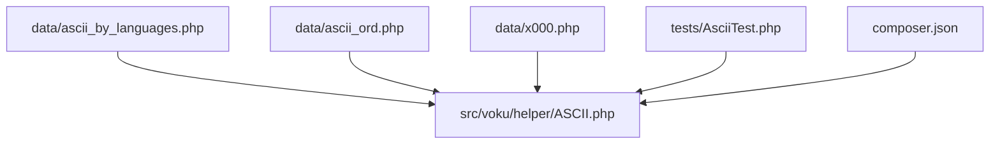

# voku/portable-ascii

> Bibliothèque PHP sans dépendance pour translittérer et nettoyer du texte en ASCII.

## Le problème
Convertir du texte Unicode en ASCII (slugs, noms de fichiers) dépend souvent d'extensions PHP absentes du serveur.

## Ce que ça fait vraiment
Une classe statique `ASCII.php` charge à la demande des tables par langue et par plan Unicode (dossier `data`). Méthodes : `to_ascii`, `to_transliterate`, `to_slugify`, `to_filename`, `clean`, `normalize_msword`, `remove_invisible_characters`. Aucune extension requise (PCRE seulement).

## Comment c'est branché


## Essayer
```bash
composer require voku/portable-ascii
./vendor/bin/phpunit
```

## Coût et pièges
Gratuit. PHP 7.1 minimum. Un exemple du README contient des caractères corrompus. La translittération perd des informations.

## Ce que ce n'est pas
Ce n'est pas un outil de normalisation Unicode complet ni de traduction.

## Alternatives
- voku/Stringy : version orientée objet, citée dans le README.

## Pour toi
À ignorer : bibliothèque PHP ; en Python, une translittération équivalente existe déjà dans l'écosystème.

