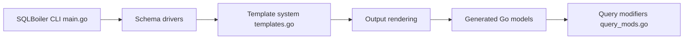

# volatiletech/sqlboiler

> "Database-first" Go ORM generator, in maintenance mode, working from an existing schema.

## The problem
Hand-writing repetitive, untyped `database/sql` code for an existing schema.

## What it actually does
Reads a database schema (PostgreSQL, MySQL, MSSQL, SQLite via drivers) and generates typed Go models with queries, relations, eager loading, hooks, transactions and upsert. Regenerating with `--wipe` is recommended. The README benchmarks date from Go 1.8.

## How it is wired


## Trying it
```bash
go install github.com/aarondl/sqlboiler/v4@latest
go install github.com/aarondl/sqlboiler/v4/drivers/sqlboiler-psql@latest
sqlboiler psql
go test ./models
```

## Cost and gotchas
Free; the `sqlboiler.toml` configuration is mandatory. Every table must have a primary key. The generated tests are fragile.

## What it is not
In maintenance: no new features, issues rarely handled. The README points to more active projects.

## Alternatives
Bob (inspired by SQLBoiler, actively maintained); sqlc (generates typed code from SQL, without an ORM).

## For you
Ignore: a Go tool, in maintenance, unrelated to data/AI work.
