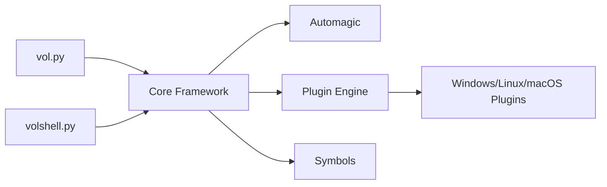

# volatilityfoundation/volatility3

> Python framework for RAM forensic analysis, for investigators and incident-response analysts.

## The problem
After an incident, a machine's in-memory state (processes, connections, modules) disappears at shutdown. It must be extracted from a dump without depending on the suspect system.

## What it actually does
Reads a memory sample and runs plugins per operating system (Windows, Linux, macOS). Memory layers and automatic detection (automagic) prepare the context; symbol tables translate raw structures. Windows: symbols downloaded on demand. Linux and macOS: tables must be produced, for example with dwarf2json. A complete rewrite from 2019, under the Volatility Software License, a custom license.

## How it is wired


## Trying it
```bash
pip install volatility3
vol -h
vol -f /home/user/samples/stuxnet.vmem windows.info
```

## Cost and gotchas
Free. Python 3.8+. The first pass over a symbol pack updates the cache, which can take a while. Analyze only samples you have the right to hold.

## What it is not
Not a memory acquisition tool: it analyzes existing dumps. The VSL license is not recognized by GitHub: read it before redistributing.

## Alternatives
No alternative named in the README (the historical Volatility 2 version is mentioned).

## For you
Watch: useful if you do incident response on ML infrastructure, otherwise out of scope; check the VSL license first.
