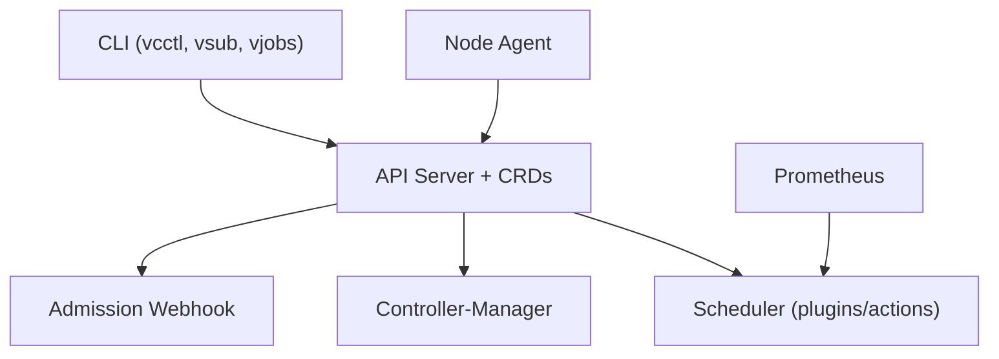

# volcano-sh/volcano

> Ordonnanceur de jobs batch pour Kubernetes, destiné aux charges IA, big data et HPC.

## Le problème
Le kube-scheduler place les pods un par un, mal adapté aux jobs distribués qui doivent démarrer ensemble avec des files, des priorités et des quotas.

## Ce que ça fait vraiment
Volcano ajoute un ordonnanceur à plugins (binpack, drf, capacity, topologie…), des CRD (Job, PodGroup, Queue, JobFlow), un contrôleur, un webhook d'admission et un agent par nœud. Il s'intègre à Spark, Flink, Ray, PyTorch, TensorFlow, Kubeflow, MPI et d'autres. Les pods demandent l'ordonnanceur `volcano`, qui les lie aux nœuds.

## Comment c'est branché


## Essayer
```bash
kubectl apply -f https://raw.githubusercontent.com/volcano-sh/volcano/master/installer/volcano-development.yaml
helm repo add volcano-sh https://volcano-sh.github.io/helm-charts
helm install volcano volcano-sh/volcano -n volcano-system --create-namespace
```

## Coût et pièges
Gratuit, mais il faut un cluster Kubernetes (1.12+ annoncé) ; le YAML « development » du README n'est pas un jalon stable. 850 issues ouvertes. Vérifie la matrice de compatibilité Kubernetes avant de choisir une version.

## Ce que ce n'est pas
Pas un framework d'entraînement : il place les jobs, il ne les écrit pas. Il ne remplace pas kube-scheduler pour les services classiques.

## Alternatives
Aucune alternative citée dans le README.

## Pour toi
À surveiller : utile dès que tu partages un cluster GPU entre équipes d'entraînement, inutile sinon. Projet CNCF en incubation, très actif.

