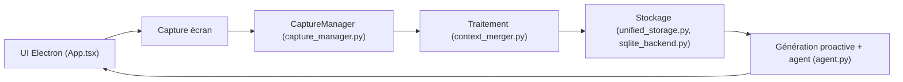

# volcengine/MineContext

> Desktop application that captures your screen and extracts summaries, to-dos and activities from it, for knowledge workers.

## The problem
The digital context of a working day is scattered; retrieving it or drawing syntheses from it takes manual effort.

## What it actually does
It takes screenshots at an adjustable interval (5 s in the example), interprets them with a vision-language model, computes embeddings, stores locally (SQLite, ChromaDB) and generates daily/weekly summaries, tips and todos on the home page; a chat lets you query this context. Electron/React frontend, FastAPI backend. Doubao, OpenAI or any OpenAI-compatible service models, including local ones.

## How it is wired


## Trying it
```bash
uv sync
source .venv/bin/activate
uv run opencontext start --port 1733
```

## Cost and gotchas
VLM + embeddings API key at your expense (Doubao recommended by the README); screen recording permission required. Screenshots are sent to the provider if the model is not local. The data path cited is the macOS one.

## What it is not
Sources other than the screen and notes (files, links, MCP) are at the roadmap stage. "Local-first" only holds if you plug in a local model.

## Alternatives
Dayflow and ChatGPT Pulse are compared in the README; MineContext presents itself as richer and open.

## For you
Curious for context engineering, but continuous screen capture to a third-party API: test only with a local model (LMStudio) and away from sensitive data.
