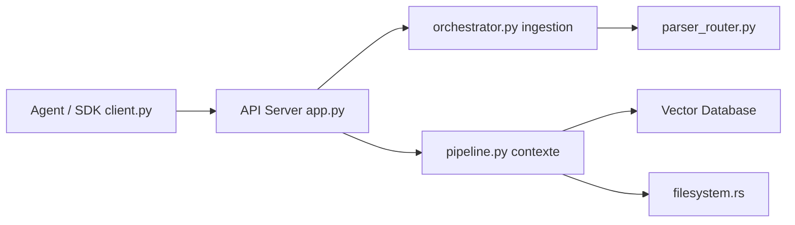

# volcengine/OpenViking

> Context database for AI agents, organized as an inspectable virtual file system.

## The problem
An agent's memory is often a black box of embeddings that you can neither read nor correct.

## What it actually does
Resources, memories and skills are filed under `viking://`, navigable with `ls`, `tree`, `grep`, `find`. Each directory carries a generated L0 summary and L1 overview; the full content (L2) is read only when needed. Vector search restricted to a subtree, archived sessions and memories extracted as Markdown. Server, `ov` CLI, Python/Go/TS SDKs, MCP.

## How it is wired


## Trying it
```bash
pip install openviking --upgrade
openviking-server init
openviking-server
ov add-resource https://github.com/volcengine/OpenViking
ov find "what is openviking"
```

## Cost and gotchas
Requires an embedding model and a VLM (cloud or local Ollama). AGPL-3.0; commercial editions in parallel. Configure authentication before exposing the server.

## What it is not
Not a generic vector database. The cited benchmarks are the vendor's own, with its own Doubao models.

## Alternatives
None named as an alternative (deer-flow and Hermes Agent are partners).

## For you
A readable-memory approach relevant to agent RAG: keep a close eye on it.
